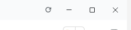

# dsh-restart-button

A restart button for the Windows title bar of DeepSeek Harness Desktop, sitting just left of the minimize control. One click relaunches the Electron shell and its Harness Host, so a freshly installed or replaced plugin takes effect without quitting from the tray and reopening by hand. The button hides itself in a browser-hosted GUI and in fullscreen; it asks for confirmation because running tasks are interrupted.



在 **Windows 桌面端** 窗口标题栏右上角、**最小化按钮左侧**加一个重启按钮。装完 / 替换插件后点一下就能重启 DeepSeek Harness，不用再去托盘菜单退出、再手动打开。

## 行为

- 只在 Windows 桌面端窗口里出现。浏览器打开的 Web GUI 没有可重启的外壳，按钮自动隐藏。
- 位置来自系统的 Window Controls Overlay：`navigator.windowControlsOverlay.getTitlebarAreaRect()` 的右边缘正是最小化按钮的左边缘，再留 4px 间距；窗口缩放、进出全屏会自动重新贴合。
- 点击先弹出确认框（说明会中断正在运行的任务），确认后才发请求；重启中显示「正在重启…」。
- 如果 7 秒后页面仍在，说明重启没发生，按钮上会出现红点并提示重试或手动退出——不会假装成功。

## 工作原理

DeepSeek Harness 桌面端是 Electron：只有它自己的主进程能调用 `app.relaunch()`，而 Harness Host 是它的子进程，插件没有任何受支持的 API 能请求外壳重启。所以插件用一条不依赖外壳生命周期的路径：

1. **Client 半边**（`dsh/client.js`）在 `shell.overlay` 插槽画出标题栏按钮，确认后 `POST /plugins/restart-button`（同源，带 Harness 自己的会话 Cookie）。
2. **Host 半边**（`dsh/index.js`）用 `ctx.connection.authorizeIndex()` 校验请求，写两个 PowerShell 脚本，然后以隐藏子进程启动第一段。
3. **第一段**先通过 WMI（`Win32_Process.Create`）把**第二段**挂到 WmiPrvSE 服务下面——它不再是本进程树的子孙，因此后面无论结束谁都不影响它；随后结束外壳主进程与本 Host。
4. **第二段**等旧外壳进程消失，再隔 0.8 秒用 WMI 把应用拉起来（`Win32_Process.Create`，父进程是 WmiPrvSE，没有控制台、也不在本进程树里）；每 2 秒确认一次，最多重试 5 次。

两段分工是必须的：本机实测，`detached` 启动的 PowerShell **根本不会执行**（同参数的非 detached 可以），而普通子进程会随父进程一起被结束，所以「挂到 WMI 下」才是能活到重启那一刻的做法。应用也必须由 WMI 而不是 `Start-Process` 拉起：`Start-Process` 会让新实例继承 PowerShell 的控制台，那个控制台一关，客户端就跟着退出了。

脚本只按「同一 exe、非 Chromium 子进程、非 dsh-desktop-host」筛选，不做 `taskkill /T` 整树结束，因此不会误伤自己或其它同名子进程。每一步都写进 `%TEMP%\dsh-restart-button\restart.log`，没起来可以对着日志看卡在哪一步。

> 说明：这是**强制结束**式重启。桌面端把窗口关闭解释为「最小化到托盘」，Host 也只能由父进程的 IPC 通道正常关闭，插件无法触发优雅退出，所以正在运行的任务会被中断——确认框里已明确提示。

## 安装

```powershell
# 在 DSH 里用插件管理器安装本目录（绝对路径）
```

或用 `plugin_manager` 的 `install_bundle`，`target` 指向本包目录。装好后若是第一次安装、按钮还没出现，手动重启一次；之后就能一直用这个按钮。

## 安全与限制

- 路由 `/plugins/restart-button` 与页面同源，由 Harness Web 服务器的会话 Cookie 鉴权；未登录的本地进程得到 401。
- 仅 `win32` + Electron Node 模式 + 有父进程时报告 `supported: true`；其他环境返回 409 并隐藏按钮。
- 重启脚本写在 `%TEMP%\dsh-restart-button\`，每次重启一个新文件（几 KB），可随时自行清理。
- 若应用被移到新路径安装，按 `process.execPath` 重新启动，无需改配置。
